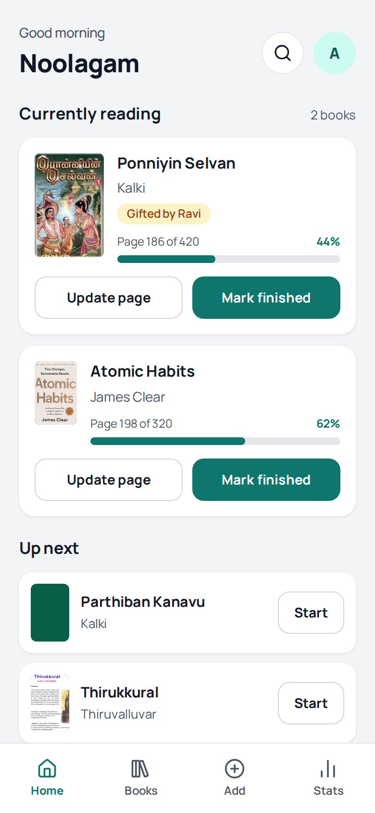
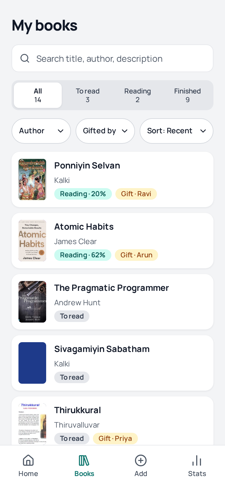
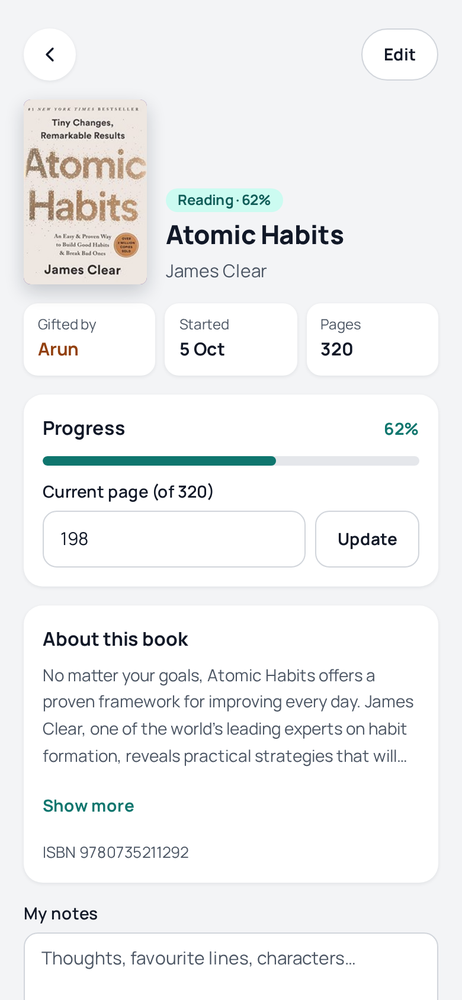
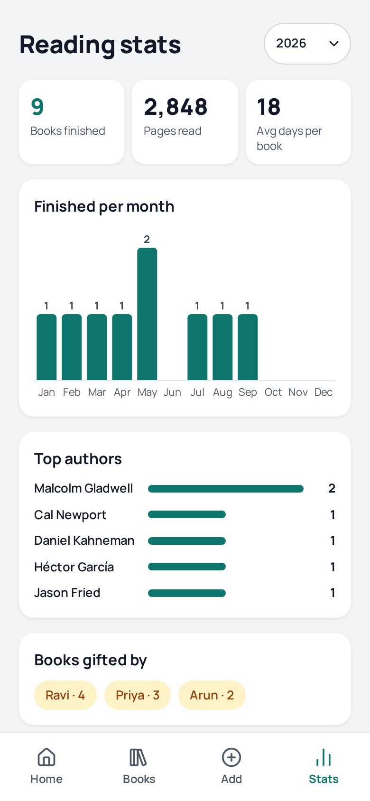
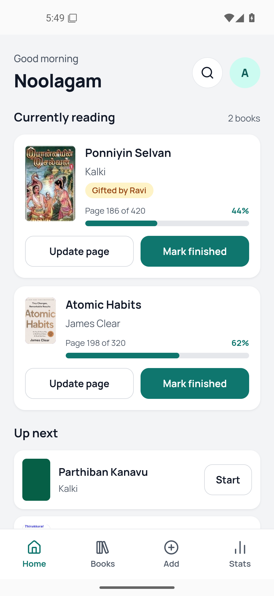
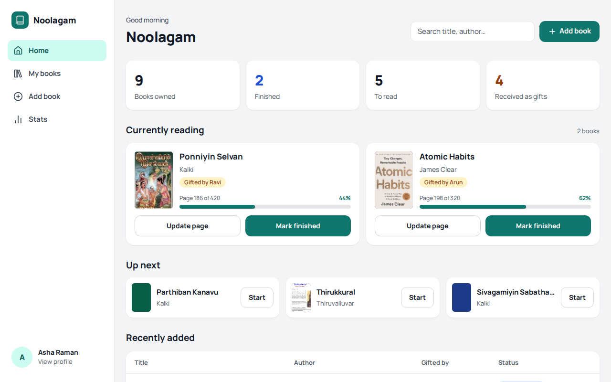
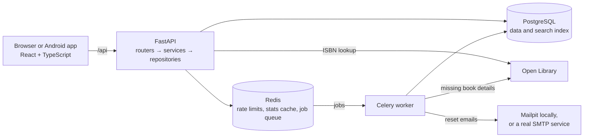
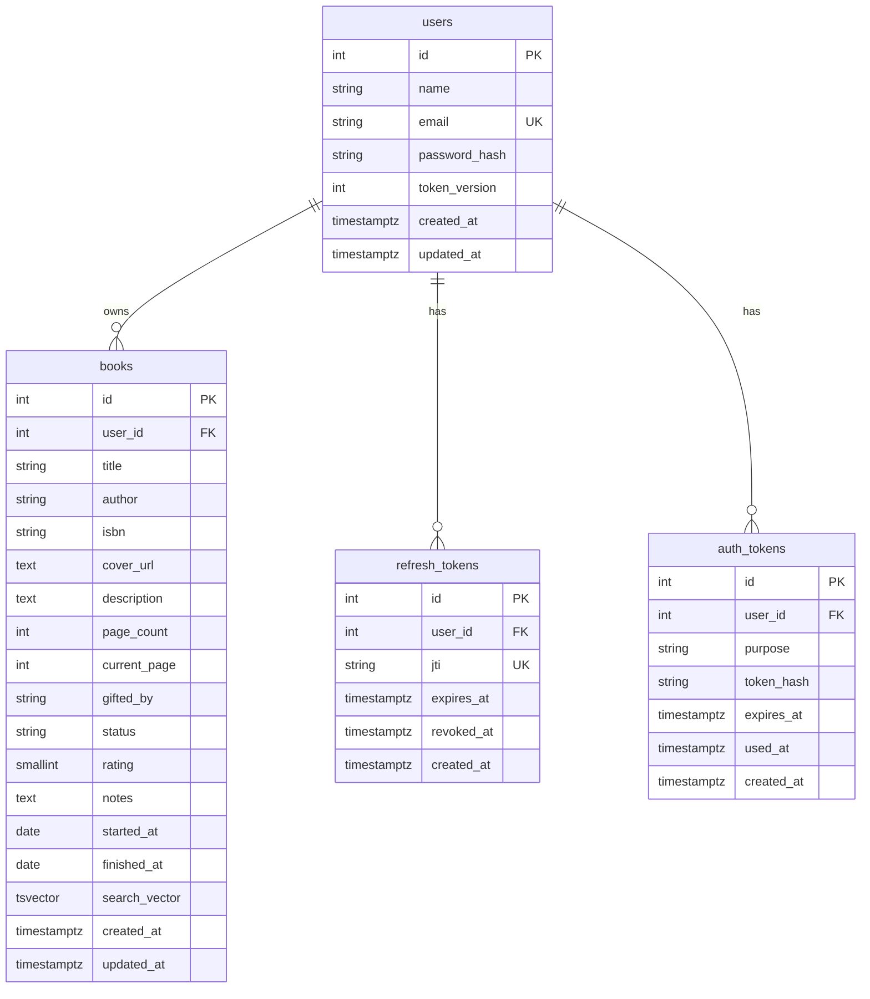

# Noolagam

**Track the books you own, who gave them to you, and what you are reading.**

Noolagam (நூலகம்) means "library" in Tamil. Each person gets a private library with reading progress, notes, full-text search and yearly stats. Add a book by its ISBN and the cover, description and page count are filled in automatically.

Built with FastAPI, PostgreSQL, Redis, Celery and React. The same React code runs as a website and as an Android app, built with Capacitor.

> **Status:** every feature below works locally on the web and on Android, with 297 backend tests (96% coverage) and 207 frontend tests. There is no live demo yet, so the Android app needs a backend running on the same Wi-Fi. CI and a production frontend image are still to come: see [Roadmap](#roadmap).

## Screenshots

<p>
  
  
  
  
</p>

The screenshots above are from a phone's browser. The Android app shows the same screens:



They also adapt to a laptop:



## Features

- **Accounts:** sign up, log in, stay logged in across reloads, forgotten password by email, change password, edit profile.
- **Your library:** add, edit and delete books, and record who gifted each one.
- **ISBN lookup:** fill in a book's details from [Open Library](https://openlibrary.org) before saving it.
- **Automatic details:** a background job looks for anything still missing after a book is saved, retrying if Open Library is down.
- **Reading flow:** start a book, update your page, mark it finished with a 1–5 rating, and keep private notes. Several books can be in progress at once.
- **Finding books:** ranked search across title, author and description, including Tamil text, plus filters, sorting and infinite scroll.
- **Stats:** books finished, pages read and average days per book for any year, with a monthly chart, top authors and who gifted you the most.
- **Privacy:** every book query is limited to the logged-in user, and another user's book returns 404.

## Architecture



Routers only handle HTTP, services hold the business rules, and repositories hold all database queries. Slow work such as sending email and calling Open Library runs in the Celery worker, so a request never waits for it.

## Database



## Tech stack

| Area | Tools |
|---|---|
| **Backend** | Python 3.12, FastAPI, SQLAlchemy 2.0 (async) with asyncpg, Alembic, Pydantic v2 |
| **Data** | PostgreSQL 16 with `tsvector` full-text search, Redis |
| **Background jobs** | Celery, Jinja2 email templates, httpx |
| **Auth** | JWT access and refresh tokens (PyJWT), bcrypt |
| **Frontend** | React 18, TypeScript, Vite, Tailwind CSS, React Router, TanStack Query, Axios, React Hook Form, Zod, Recharts |
| **Testing and quality** | pytest, Vitest, React Testing Library, Ruff, mypy, ESLint |
| **Android** | Capacitor 8, `@capacitor/preferences`, `@capacitor/app` |
| **Local setup** | Docker Compose, Mailpit |

## Run it locally

You only need [Docker](https://docs.docker.com/get-docker/) with Compose.

```bash
git clone https://github.com/naveenkumarb-tech/noolagam.git
cd noolagam
docker compose up --build
```

The first start takes a few minutes. Database migrations run automatically, and no configuration is needed.

| Service | Address |
|---|---|
| The app | http://localhost:5173 |
| API documentation (Swagger) | http://localhost:8000/docs |
| Mailpit, which catches all emails | http://localhost:8025 |

**Try it:** create an account at http://localhost:5173/signup, then add a book. For sample data, run this with your account's email:

```bash
docker compose exec api python -m app.cli seed-books you@example.com
```

**Password reset emails** appear in Mailpit, so no real email is sent unless you set it up.

**To stop:** `docker compose down` keeps your data, and `docker compose down -v` deletes it.

> On Linux, if your user ID isn't 1000, start with `UID=$(id -u) GID=$(id -g) docker compose up --build`, so that the frontend can write its dependencies.

### Sending real email (optional)

Copy `.env.example` to `.env` and fill in an SMTP service. It needs STARTTLS, usually on port 587. Then run `docker compose up -d`. `.env` is ignored by Git, and `.env.example` explains each setting.

For Gmail, use an [App Password](https://myaccount.google.com/apppasswords), which requires 2-Step Verification. Your normal password won't work.

## Android app

Build the APK with Docker. You don't need Java or Android Studio. The API address is built into the app:

```bash
# A backend on your computer, for phones on the same Wi-Fi (find your address with: hostname -I)
frontend/build-apk.sh http://192.168.1.50:8000

# Or a hosted backend, which works anywhere
frontend/build-apk.sh https://api.example.com
```

The first build takes several minutes, and the result is `apk/noolagam-debug.apk`.

To install it, copy the file to your phone and open it, allowing installs from that app when Android asks. Later builds on the same computer update the app in place and keep you logged in. This is a debug build, for sideloading rather than the Play Store.

With a backend on your computer, the computer must be on and running `docker compose up`, and your phone on the same Wi-Fi. The app only allows plain `http://` when it was built with an `http://` address, and if your computer's address changes, the app needs rebuilding.

The app talks to the same API as the website, with one difference: it can't rely on a browser's cookie between launches, so it keeps its refresh token in the app's private storage, and that storage is excluded from Android backups.

For install steps, security notes and troubleshooting, see the [Android README](frontend/android/README.md).

## API

Everything is under `/api/v1`. Full details are in the [Swagger docs](http://localhost:8000/docs) while the app is running.

| Method | Endpoint | Purpose |
|---|---|---|
| POST | `/auth/register` | Create an account and log in |
| POST | `/auth/login` | Log in |
| POST | `/auth/refresh` | Get a new access token and rotate the refresh token |
| POST | `/auth/logout` | End this session |
| POST | `/auth/forgot-password` | Email a reset link (the same response for any email) |
| POST | `/auth/reset-password` | Set a new password with a reset link's token |
| GET, PATCH | `/users/me` | Read or update your profile |
| POST | `/users/me/change-password` | Change your password and log out other devices |
| GET, POST | `/books` | List books, or add one |
| GET, PATCH, DELETE | `/books/{id}` | Read, edit or delete a book |
| POST | `/books/{id}/start` | Start reading |
| POST | `/books/{id}/progress` | Update the current page |
| POST | `/books/{id}/finish` | Mark as finished, with an optional rating |
| POST | `/books/{id}/reset` | Move back to To-read |
| GET | `/books/current` | Books being read |
| GET | `/books/counts` | Counts for each status |
| GET | `/books/facets` | Authors and gifters, for filters |
| GET | `/books/lookup?isbn=` | Look up an ISBN on Open Library |
| GET | `/search?q=` | Full-text search, best match first |
| GET | `/stats?year=` | Yearly stats and chart data |

`GET /health` and `GET /ready` check that the service is up and that it can reach the database and Redis.

### Examples

Create an account. The response has an access token, and the refresh token is saved as an httpOnly cookie:

```bash
API=http://localhost:8000/api/v1

curl -c cookies.txt -X POST "$API/auth/register" \
  -H 'Content-Type: application/json' \
  -d '{"name": "Meena", "email": "meena@example.com", "password": "correct-horse-battery"}'
```

Copy the `access_token` from the response, then add a book and read it:

```bash
TOKEN=paste-your-access-token-here

curl -X POST "$API/books" \
  -H "Authorization: Bearer $TOKEN" -H 'Content-Type: application/json' \
  -d '{"title": "Ponniyin Selvan", "author": "Kalki", "page_count": 420, "gifted_by": "Ravi"}'

# Use the "id" from the response in place of 1.
curl -X POST "$API/books/1/start" -H "Authorization: Bearer $TOKEN"

curl -X POST "$API/books/1/progress" \
  -H "Authorization: Bearer $TOKEN" -H 'Content-Type: application/json' \
  -d '{"current_page": 186}'

curl -X POST "$API/books/1/finish" \
  -H "Authorization: Bearer $TOKEN" -H 'Content-Type: application/json' \
  -d '{"rating": 5}'
```

Browse and search:

```bash
curl "$API/books?status=finished&author=Kalki&sort=title" -H "Authorization: Bearer $TOKEN"
curl "$API/search?q=ponniyin" -H "Authorization: Bearer $TOKEN"
curl "$API/stats?year=2026" -H "Authorization: Bearer $TOKEN"
```

Errors share one format, and `request_id` matches the `X-Request-ID` response header:

```json
{"error": {"code": "BOOK_NOT_FOUND", "message": "Book not found", "request_id": "7d79b847..."}}
```

## Tests

Tests run against a real PostgreSQL and Redis, using a separate database. Open Library and email are replaced with fakes.

```bash
# Backend: lint, types, and tests with coverage
docker compose run --rm api sh -c "ruff check . && ruff format --check . && mypy app && pytest"

# Frontend: types, lint, tests and production build
docker run --rm --user "$(id -u):$(id -g)" -e HOME=/tmp -v "$PWD/frontend":/app -w /app node:22-alpine \
  sh -c "npm ci && npm run typecheck && npm run lint && npm run test && npm run build"
```

## Design decisions

**Layered backend.** Keeping HTTP, business rules and database queries apart means rules such as "a rating is only allowed on a finished book" live in one place, and every book query can be limited to the current user.

**Token security**
- The access token lasts 15 minutes and is held only in memory. The refresh token lasts 7 days, in an httpOnly cookie that JavaScript can't read. The Android app keeps it in private app storage instead, and a cookie alone can never make the API reveal it.
- Refresh tokens rotate on every use. Reusing an old one is treated as theft and ends all of that user's sessions.
- Each token carries a version number. A password reset or change raises it, which immediately ends every existing session.
- Reset tokens are stored only as SHA-256 hashes, work once and expire in 30 minutes. They are created inside the worker, so the raw token never passes through the job queue.
- Login and forgot-password don't reveal whether an email is registered, including through response timing.
- Login, sign-up, forgot-password and change-password are rate limited per IP and per email.

**Stats caching.** Stats are cached in Redis per user, under a key containing a version number that any relevant change increments. If a book changes while stats are being calculated, the old result is saved under the old version, where nothing will read it. If Redis is down, stats are simply calculated each time.

**Careful book matching.** Searching Open Library by title only accepts a close match on both title and author, and any numbers in the title must match, so "Part 1" never takes the cover of "Part 2". A missing cover is better than a wrong one. The job only fills empty fields, so it never overwrites what the reader entered.

**ISBN lookup uses two sources.** Open Library's edition data is often missing the author or cover, while its search data may give the original title in another language. Combining them gets both right.

**Search in any language.** Search uses PostgreSQL's language-neutral `simple` configuration, because a library can mix English and Tamil. Words in the title rank above the author, which rank above the description.

**Dates come from the reader's device.** A server's UTC date can be a day off for someone in India, and books read long ago need their real dates, so the client sends its local date.

## Deployment notes

This hasn't been deployed yet. When it is, it will need:

- **Backend:** `backend/Dockerfile` has a `prod` target that runs Gunicorn with Uvicorn workers and applies migrations on start. Services such as Render, Railway or AWS EC2 would work, with managed PostgreSQL and Redis.
- **Worker:** a second process running the same image: `celery -A app.worker.celery_app worker`.
- **Frontend and API on one origin:** browsers can block the refresh cookie across different sites, so the plan is for Nginx to serve the app and proxy `/api`.
- **Settings:** see `backend/.env.example`. In production, the app refuses to start with insecure cookies or the development JWT secret.
- **HTTPS and real email**, with `FRONTEND_URL` set to the public address so that reset links work.

## Roadmap

- [x] Android APK built with Capacitor
- [ ] Installable web app (PWA) and a production frontend image with Nginx
- [ ] GitHub Actions for lint, tests, builds and publishing the APK
- [ ] Structured JSON logging and OpenTelemetry tracing
- [ ] Scheduled cleanup of expired tokens
- [ ] Live demo
